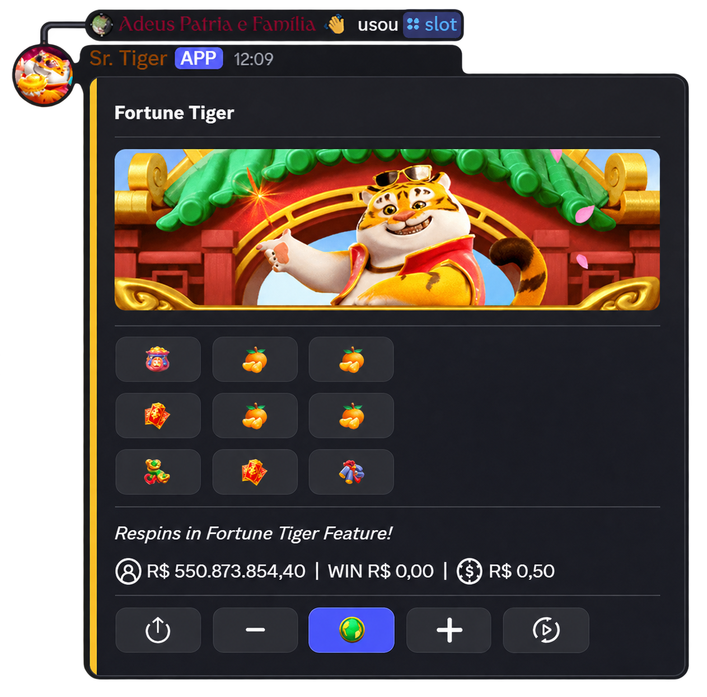

# Fortune Tiger Bot

Bot de Discord com um slot 3×3 inspirado no Fortune Tiger, economia de moeda virtual (Créulas), rodadas automáticas e efeitos de áudio. Os saldos ficam em SQLite e são compartilhados entre os servidores atendidos pela mesma instância.

Esse projeto foi **vibecodado para uma piada interna entre amigos**, mas acabou ficando bom demais para não jogar no GitHub. A ideia sempre foi dar risada e brincar com uma economia fictícia no Discord.

**Não apoio nenhum tipo de monetização em cima deste projeto:** venda do bot, acesso pago, assinaturas, anúncios, venda de moeda virtual ou exploração com apostas em dinheiro real. Ele foi feito para diversão, sem dinheiro envolvido.

<p align="center">
  
</p>
<p align="center">
  <sub>Interface do jogo no Discord</sub>
</p>

## Comandos

| Comando | Função |
| --- | --- |
| `/slot [aposta]` | Abre o jogo, com cinco linhas de pagamento, Wild e respins. |
| `/work` | Recompensa aleatória, disponível a cada hora. |
| `/daily` | Recompensa diária com bônus por dias consecutivos. |
| `/pay usuário quantia` | Transfere moeda virtual para outro usuário. |
| `/balance [usuário]` | Consulta seu saldo ou o de outro usuário. |
| `/leaderboard` | Exibe o ranking de saldos. |
| `/mute` | Alterna os efeitos de áudio para o usuário. |
| `/changelog` | Mostra as alterações da versão mais recente. |

## Executar localmente

Requer **Node.js 22.12 ou superior** e npm. As dependências incluem módulos nativos; se não houver binário compatível com seu sistema, a instalação pode precisar de Python e ferramentas de compilação C/C++.

1. Instale as dependências com `npm ci`.
2. Copie `.env.example` para `.env` e preencha:

   ```dotenv
   DISCORD_TOKEN=token_do_bot
   CLIENT_ID=id_da_aplicacao
   GUILD_ID=id_do_servidor
   ```

3. Configure os emojis em `utils/emojis.js`. Os IDs incluídos pertencem ao servidor original e precisam estar acessíveis ao bot ou ser substituídos pelos seus.
4. Registre os comandos no servidor e inicie:

   ```sh
   npm run deploy
   npm start
   ```

O registro substitui os comandos desta aplicação no servidor indicado por `GUILD_ID`. Execute-o novamente quando alterar nomes, opções ou limites de comandos.

No Discord, instale a aplicação com os escopos `bot` e `applications.commands`. O bot precisa visualizar o canal, enviar mensagens e incorporar links; para áudio, também conectar e falar no canal de voz. O código utiliza os intents de servidores e estados de voz, sem leitura de conteúdo das mensagens.

## Docker

Com o `.env` preenchido e Docker Compose instalado:

```sh
docker compose build
docker compose run --rm bot npm run deploy
docker compose up -d
docker compose logs -f bot
```

O banco fica em `./data/database.sqlite`, montado em `/data` no contêiner. Para parar, use `docker compose down`. O diretório `data` é preservado.

## Configuração e assets

- `config.json`: apostas, probabilidades, recompensas, saldo inicial e caminhos de áudio. O saldo inicial só se aplica a novos usuários.
- `utils/emojis.js`: emojis dos símbolos e controles.
- `assets/gifs/urls.json`: URLs públicas usadas nas mensagens. Os GIFs locais ficam em `assets/gifs/` como arquivos de origem; o bot não os hospeda automaticamente.
- `assets/audio/card_song.mp3`: áudio da feature.
- `assets/audio/big_win.mp3`: áudio opcional de vitória. Adicione seu arquivo para habilitá-lo; ele não é versionado. Sem ele, o jogo continua funcionando.
- `version.json`: versão exibida pelo bot e histórico do `/changelog`.

Os limites de vitória em `audio` representam múltiplos da aposta. Por padrão, a feature tem 2% de chance e o tabuleiro completo aplica multiplicador de 10×.

## Persistência

Fora do Docker, o banco padrão é `database.sqlite` na raiz. Para escolher outro caminho, defina `DB_PATH` no `.env`; o diretório é criado automaticamente. Caminhos relativos são resolvidos a partir da pasta de execução.

Para fazer backup, pare o bot e copie o banco. Não apague os arquivos auxiliares `-wal` e `-shm` enquanto a aplicação estiver rodando. `.env`, bancos, dependências e dados locais estão excluídos do Git e do contexto de build do Docker.

## Desenvolvimento

```sh
npm run check
npm test
```

A checagem valida a sintaxe dos arquivos JavaScript. Os testes cobrem pagamentos do slot, estados de respin, arredondamento de saldo e rollback de transações, usando banco em memória e sem conectar ao Discord.

```text
commands/          Comandos e interface do jogo
events/            Eventos do cliente Discord
database/          Persistência SQLite
utils/             Motor do slot, áudio, emojis e formatação
assets/            Áudios, GIFs e suas URLs
scripts/           Checagens locais
test/              Testes automatizados
index.js           Inicialização do bot
deploy-commands.js Registro dos comandos
```

## Uso e licença

Projeto de entretenimento com moeda virtual, sem depósitos ou saques de dinheiro real. Não possui afiliação com a PG Soft.

A posição contra monetização acima expressa a intenção do autor. Uma licença de distribuição ainda não foi adotada neste repositório; essa declaração não substitui os termos de uma licença. Marcas, imagens, áudios e dependências de terceiros continuam sujeitos aos direitos e licenças de seus respectivos titulares.
